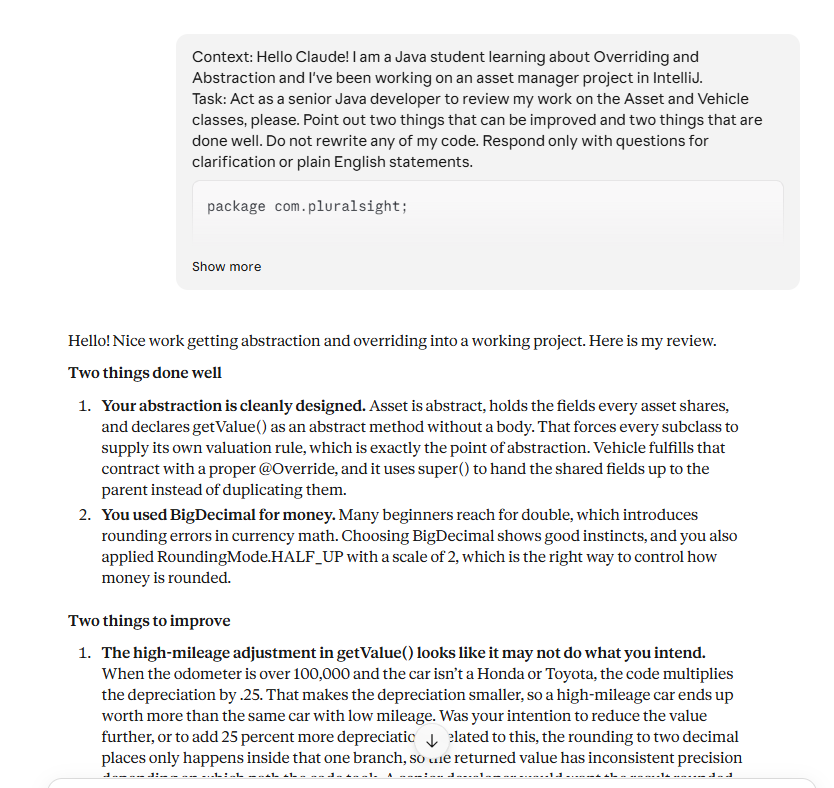
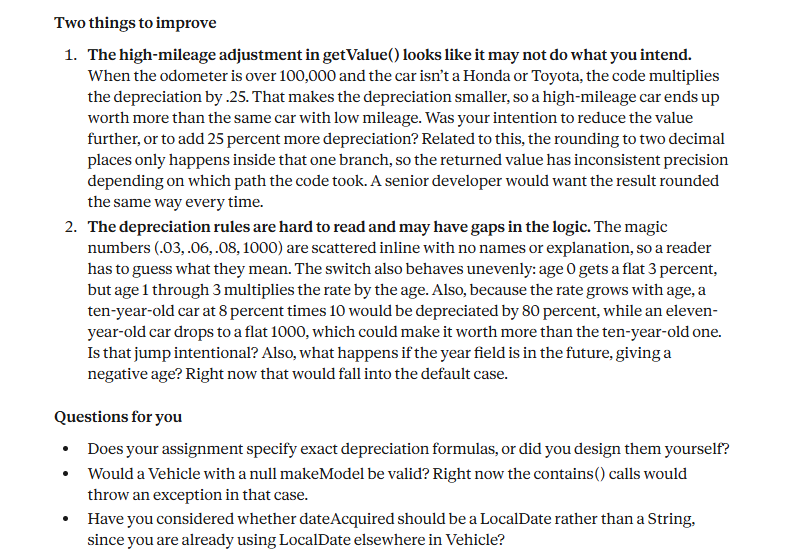
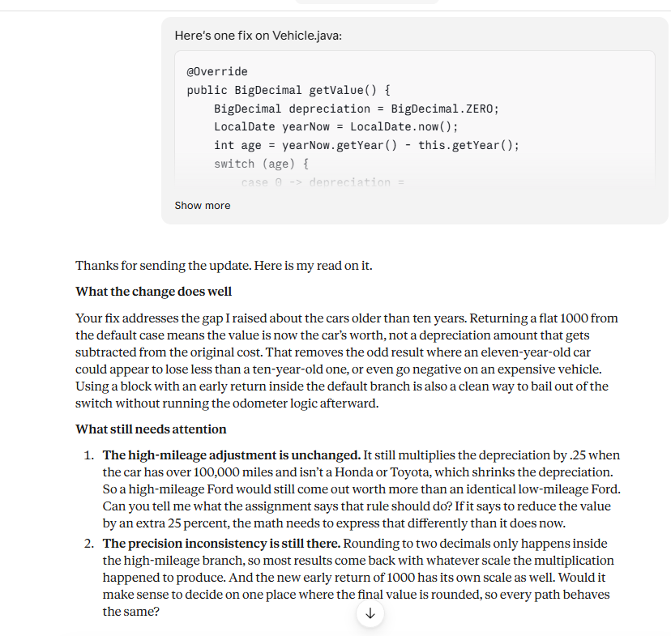
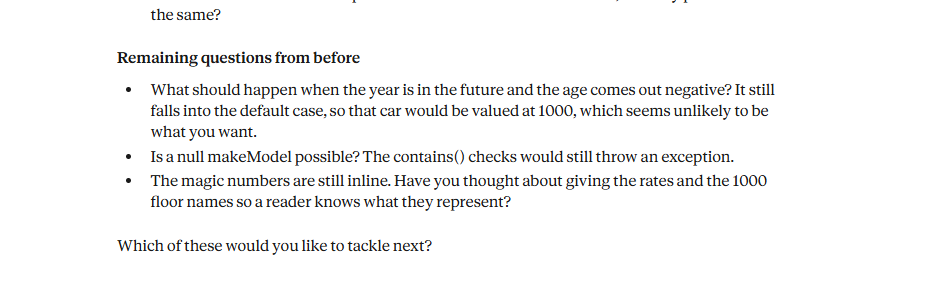
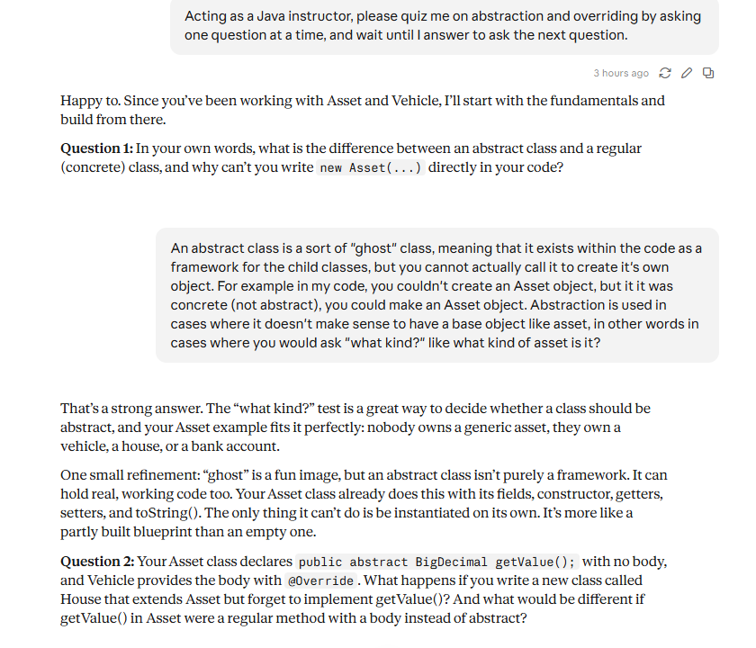
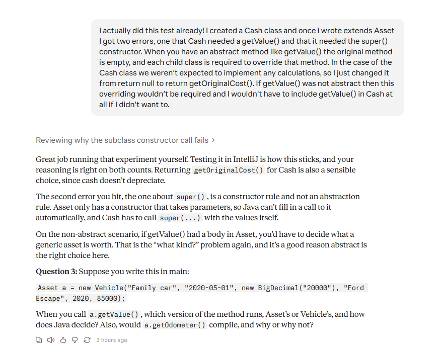
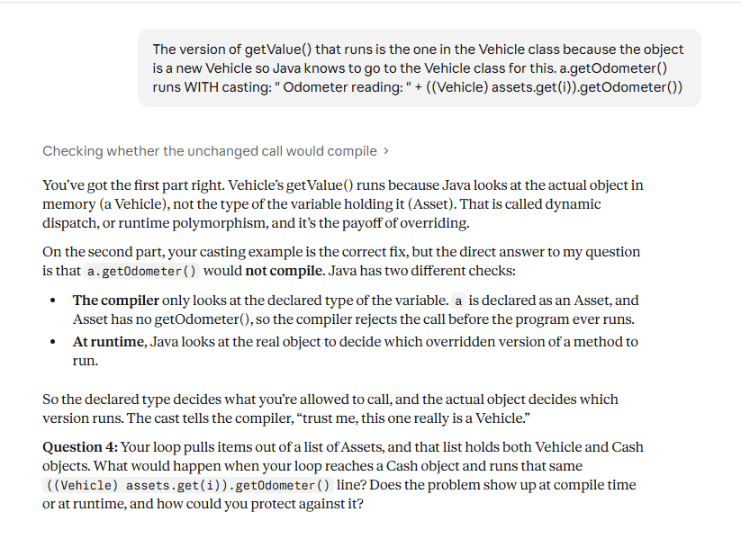
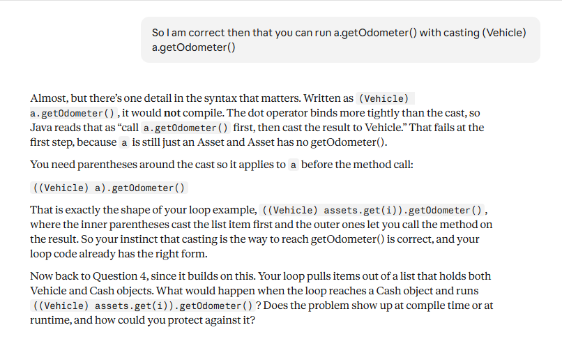
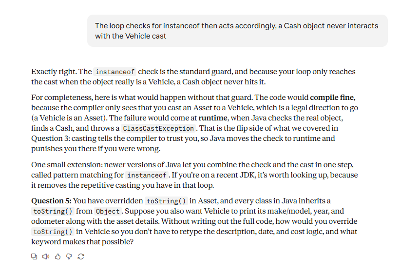

# Asset Manager
Asset Manager is a command line app that allows the user to keep track of their assets (practice in overriding and abstraction)

### Exercise question:
##### What issues are you running into when you try to create the Cash class? What are your options to address these issues? 
When I first implemented the Cash class there were no issues, but once I added "extends Asset" the errors started popping up.
The first error that I got was that I needed to include the getValue() override method, since getValue() in Asset is abstract.
I just hovered over the class signature (where the red squiggly line was) and it offered the button to click to generate the getValue() override, so I just clicked on that and it populated.
It was set to return null, though, so I changed that to return getOriginalCost(), since the value is not supposed to change.
Next, the signature was still underlined, so I hovered again and the next error was that I didn't have the constructor based on the Asset constructor.
Again, it offered the option to just click and generate the constructor, so I did that, and it populated as expected and I didn't have to change anything.
After that, there were no more errors, so I went ahead to main() and created a new cash object to add to my assets arraylist.

### Exercise - Prompting Patterns
##### Screenshots

Quiz:

